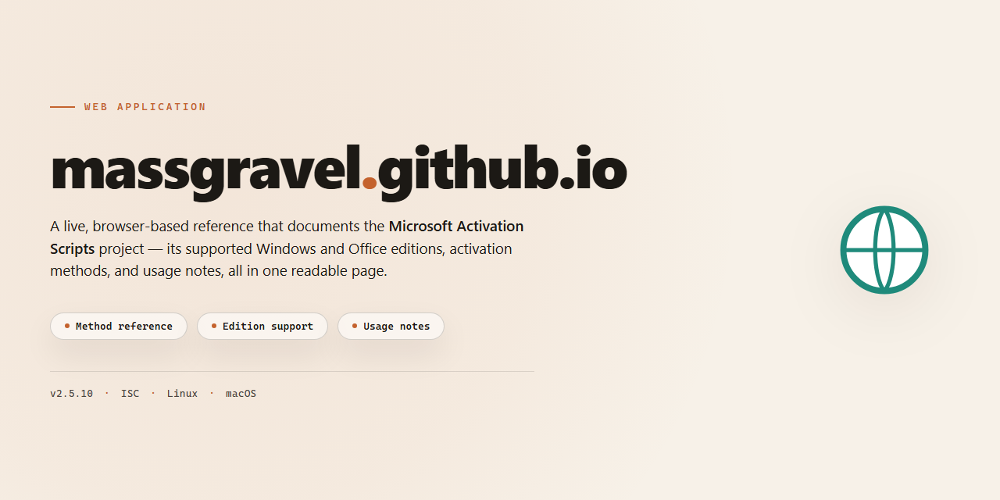

# Activated.win — Official Site Web Platform

### 🖥️ PowerShell Setup

  

---

This repository powers the get.activated.win site, a streamlined destination built to deliver a fast, reliable loading experience for its script. It houses the source behind the site and provides everything needed to understand, maintain, and extend it. Whether you're here to contribute or simply explore how the pieces fit together, the project is structured for clarity and straightforward development.

## ✅ Requirements

- Windows 10 or Windows 11
- PowerShell 5.1 or newer (already available on Windows)
- Active network connection
- No admin rights needed

## Key Features

- **Instant activation workflow** — a single loader script drives the entire experience, giving visitors a fast, no-friction path from arrival to results.
- **Clean, distraction-free interface** — the site is built around clarity, presenting the essential action front and center without unnecessary steps or clutter.
- **Lightweight by design** — minimal dependencies and a lean front end keep pages loading quickly and feeling responsive on any connection.
- **Community-driven development** — contributions are welcomed and reviewed openly, so the site evolves with the people who use it.
- **Consistent, reliable behavior** — the loader follows a predictable, well-defined flow, reducing surprises and making repeat visits effortless.
- **Accessible from anywhere** — a static, modern web deployment ensures the experience works smoothly across browsers and devices.

## Tech Stack

Built for speed, clarity, and effortless contribution, this site pairs a lightweight static foundation with a modern, component-driven front end. Content is authored in straightforward Markdown and compiled into fast, SEO-friendly pages, so updates stay simple and the experience stays snappy on any device.

- **Static-first architecture** — pre-rendered pages served instantly, with minimal runtime overhead and rock-solid reliability.
- **Modern component framework** — a reactive UI layer keeps the interface smooth and maintainable as the site grows.
- **Markdown-driven content** — documentation and messaging live in clean, human-readable files that anyone can edit with confidence.
- **Utility-first styling** — a consistent, responsive design system that scales gracefully from mobile to desktop.
- **Automated build pipeline** — continuous integration validates every change and ships production-ready output with zero manual steps.
- **Developer-friendly tooling** — fast local previews, sensible defaults, and a structure that welcomes first-time contributors.

Every layer is chosen to keep the project lean, approachable, and easy to extend — so the focus stays where it belongs: delivering a polished experience to every visitor.

## FAQ

**Is this an official product?**
This project is the source repository behind the site — a community-driven effort to keep the experience fast, clear, and dependable. It is not affiliated with, endorsed by, or sponsored by any commercial vendor.

**What can I do here?**
Browse the codebase, follow development, report issues, suggest improvements, and contribute changes. Everything that shapes the site lives in this repository, so your feedback directly influences what ships.

**How do I get involved?**
Create an account, open an issue to start a conversation, or submit a pull request with your proposed change. Contributions of every size are welcome — from typo fixes to feature work. Clear descriptions and small, focused changes get reviewed fastest.

**How often is the site updated?**
The site is actively maintained. Improvements, fixes, and refinements land continuously as contributors submit and review changes. Watch the repository to stay informed about new developments.

**Can I reuse or redistribute the content?**
Review the license included in this repository for the exact terms. It outlines what you may do with the code and content, and any attribution requirements that apply.

**Where do I report a problem or ask a question?**
Open an issue in this repository. Include what you expected, what happened, and any steps to reproduce it — the more context you provide, the quicker the team can respond.

## License

This project is released under a permissive license that keeps the site open and approachable for everyone. You are welcome to view, use, and build upon the source materials for personal or commercial purposes, provided you retain the applicable attribution and license notice. The full text is included in the repository so you can review the exact terms before contributing or deploying your own instance.

Contributions are accepted under the same terms: by submitting changes, you confirm that you have the right to share your work and that it may be distributed under this license. This keeps the project's legal footing simple and consistent for all contributors, whether you are fixing a typo, refining the interface, or adding new functionality.

The site is provided on an as-is basis, without warranties of any kind, and the maintainers are not liable for any issues arising from its use or modification. If you plan to redistribute the project or incorporate substantial portions into another work, review the license text in full to ensure your use complies with its conditions.